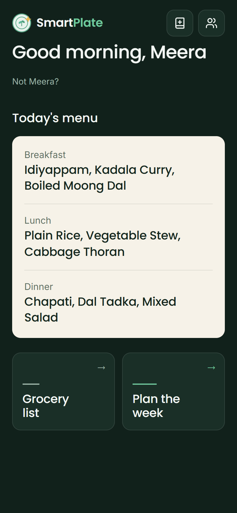
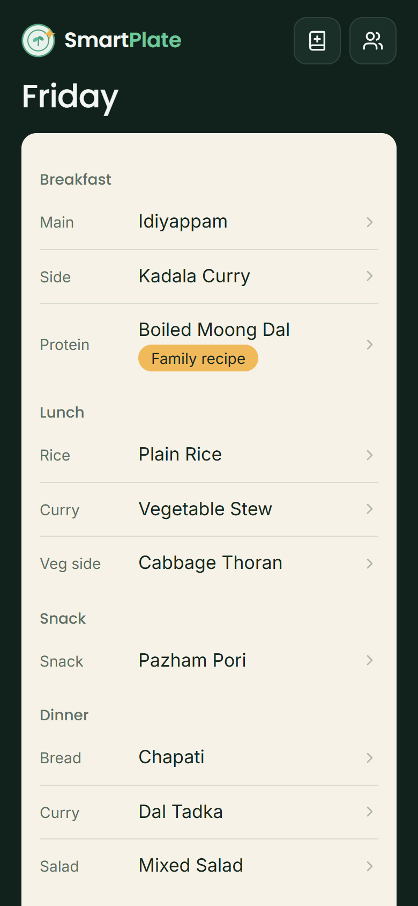

# SmartPlate

*AI meal planning, made simple*

A phone-first web app that plans a week of Kerala family meals around each person's diet and health needs, then turns the plan into a grocery list.

**Try it now: https://family-meal-planner.azurewebsites.net** (no sign-up; first load can take about 30 seconds)

 

## The problem

Planning a week of meals for a family is a daily chore, and harder when one person has diabetes, another has high cholesterol, and a third is vegetarian. It is designed to be easy for older cooks too: big buttons, one action per screen, and a layout that works on a phone.

## What it does

- **Family profiles** with diet and health conditions that become hard rules in the plan (for example, no sugary dishes for diabetes, limited fried fish for cholesterol).
- **Weekly menu** of full plates (breakfast, lunch, snack, dinner), built by Gemini AI and checked by a rule engine that enforces real food logic: sambar with idli, no rice at dinner, no fish with curd.
- **Edit by hand:** tap any dish to see the recipe, swap it, choose another, or remove it.
- **Grocery list** grouped by shop section, editable, and shareable as a checklist.
- **Own recipes, PDF export**, and installable on a phone's home screen.

## Try it

No sign-up or install needed. Open the link, pick one of the three sample people (all invented), and tap **Plan the week**. The first load can take about 30 seconds while the server wakes up.

There is no login. Visitor changes are wiped every night, and AI-built menus are limited each day (3 per visitor). After that, the app still builds menus with its own rule engine.

## How it was built

I directed Claude Code (Anthropic's AI coding assistant) to write the app, describing what was needed and reviewing the results. I made the product decisions and tested the app; I am not a traditional developer.

- **Python and FastAPI** backend, **SQLite** database, plain HTML/JavaScript with Tailwind for the interface
- **Google Gemini API** for the weekly plan, with a retry and a rule-based fallback when the AI fails
- **Microsoft Azure App Service** for hosting
- Safeguards for the public demo: daily limits on AI use, a nightly reset, and secrets kept in environment variables

## Run it yourself

```
pip install -r requirements.txt
cp .env.example .env        # then add GEMINI_API_KEY
python -m uvicorn app.main:app --port 8000
```

On any publicly reachable copy, set `DEMO_MODE=1` to switch the limits on (see `.env.example`).
